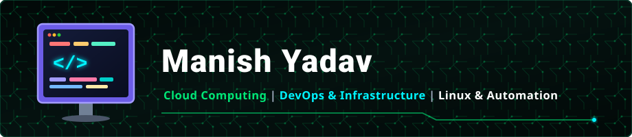

# 👋 Hello World, I'm Manish

<div align="center">
  
</div>

<br>

### 🚀 About Me

👨‍💻 I am an aspiring **Cloud & DevOps Engineer** and **Final-Year MCA Student specializing in Cloud Computing**. I am deeply focused on designing reliable cloud infrastructure, building automated CI/CD deployment pipelines, and managing containerized environments.

🐧 My core engineering pursuit revolves around **Linux Systems Administration**, **Cloud Architecture (AWS & Azure)**, **Docker Containerization**, and **Infrastructure as Code (Terraform)**. I believe in hands-on lab experimentation and codifying every repetitive process into clean, repeatable scripts.

<div align="center">
  
</div>

<br>

```javascript
const manish = {
  identity: {
    name: "Manish Yadav",
    handle: "Sudo-su-wakeup",
    education: "Final-Year MCA (Specialization in Cloud Computing)",
    targetRole: "Cloud / DevOps Engineer",
    osEnvironment: "Windows 11 Pro + WSL2 (Ubuntu) + AWS EC2",
  },

  stack: {
    scripting: ["Bash", "Shell", "PowerShell", "Python"],
    cloud: ["AWS (EC2, S3, VPC, IAM)", "Azure Labs"],
    containers: ["Docker", "Docker Compose", "Kubernetes"],
    infrastructureAsCode: ["Terraform"],
    versionControl: ["Git", "GitHub", "GitHub Actions"],
    operatingSystems: ["Ubuntu", "CentOS", "Debian", "Linux"],
  },

  featuredProject: {
    title: "Linux System Health Reporter",
    repository: "https://github.com/Sudo-su-wakeup/linux-system-health-reporter",
    tech: ["Bash", "Linux", "AWS EC2"],
    objective: "Real-time automated Linux system telemetry and diagnostics",
  },

  focus: ["Cloud Architecture", "Infrastructure as Code", "CI/CD Automation"],
  hobbies: ["Playing Cricket", "Open Source Labs"],
};
```

<br>

### 🎯 What I'm Up To

| ☁️ Cloud & Infrastructure | 🐳 Containers & DevOps | 🐧 Systems & Automation |
| :--- | :--- | :--- |
| 🌐 **AWS Core Architectures** (EC2, VPC, Subnets, S3) | 📦 **Docker Containerization** of multi-tier applications | ⚡ **Bash Automation Scripting** for daily tasks |
| 🔒 **IAM Security Policies** & Cloud Governance | ☸️ **Kubernetes Orchestration** (Pods, Services, Deployments) | 📊 **Real-time Server Diagnostics** & Health Monitoring |
| 📐 **Terraform Modular Infrastructure as Code** | 🔄 **CI/CD Pipelines** with GitHub Actions workflows | 🐧 **Linux Kernel & Process Management** internals |
| ☁️ **Azure Cloud Analytics** Laboratory Deployments | 🛡️ **Container Security** & Image Minimization | 🏏 **Cricket & Outdoor Sports** for team strategy & focus |

<br>

### 🛠 Tech Stack

<p align="center">
  <!-- Linux -->
  &nbsp;&nbsp;
  <!-- Bash -->
  &nbsp;&nbsp;
  <!-- AWS -->
  &nbsp;&nbsp;
  <!-- Azure -->
  &nbsp;&nbsp;
  <!-- Docker -->
  &nbsp;&nbsp;
  <!-- Kubernetes -->
  &nbsp;&nbsp;
  <!-- Terraform -->
  &nbsp;&nbsp;
  <!-- Git -->
  &nbsp;&nbsp;
  <!-- GitHub -->
  &nbsp;&nbsp;
  <!-- Python -->
  &nbsp;&nbsp;
  <!-- Ubuntu -->
  
</p>

<br>

### 📬 Let's Connect

Interested in collaborating on a Cloud/DevOps project, discussing infrastructure automation, or connecting professionally? Let's connect!

<p align="left">
  <a href="https://github.com/Sudo-su-wakeup?tab=repositories" target="_blank">
    
  </a>
  &nbsp;
  <a href="https://www.linkedin.com/in/manish-yadav-a1a280263/" target="_blank">
    
  </a>
</p>
