<div align="center">

  <!-- 3D Animated Cyberpunk Banner -->
  

  <br>

  <!-- Animated Typing Stream -->
  <a href="https://github.com/Sudo-su-wakeup">
    
  </a>

  <br><br>

  <!-- Social Badges -->
  <a href="https://github.com/Sudo-su-wakeup" target="_blank">
    
  </a>
  &nbsp;
  <a href="https://www.linkedin.com/in/manish-yadav-a1a280263/" target="_blank">
    
  </a>
  &nbsp;
  <a href="https://github.com/Sudo-su-wakeup?tab=repositories" target="_blank">
    
  </a>

</div>

<br>

---

```bash
manish@devops-node:~$ whoami --verbose
┌───────────────────────┬────────────────────────────────────────────────────────┐
│ PARAMETER             │ VALUE                                                  │
├───────────────────────┼────────────────────────────────────────────────────────┤
│ USER_HANDLE           │ Sudo-su-wakeup                                         │
│ ACADEMIC_STATUS       │ Final-Year MCA — Specializing in Cloud Computing       │
│ TARGET_ROLE           │ Aspiring Cloud & DevOps Engineer                       │
│ PRIMARY_ENVIRONMENT   │ Windows 11 Host · Linux VMs · AWS · Azure              │
│ CORE_PURSUIT          │ Infrastructure as Code, Automation, Systems Scripting  │
│ CURRENT_STATUS        │ Actively building hands-on labs & documenting projects │
└───────────────────────┴────────────────────────────────────────────────────────┘
```

---

<h3 align="center">⚡ Tech Stack</h3>

<p align="center">
  
  
  
  
  
  
  
  
</p>

---

<h3 align="center">📊 Statistics</h3>

<div align="center">
  <table border="0">
    <tr>
      <td align="center">
        
      </td>
      <td align="center">
        
      </td>
    </tr>
    <tr>
      <td align="center" colspan="2">
        
      </td>
    </tr>
  </table>
</div>

---

<h3 align="center">👤 About Me</h3>

<table border="0" width="100%">
  <tr>
    <td width="40%" align="center" valign="middle">
      
    </td>
    <td width="60%" valign="middle" style="padding-left: 20px;">
      <p>
        Hello! My name is <b>Manish Yadav</b>, a <b>Final-Year MCA student</b> specializing in Cloud Computing, passionate about cloud architecture, automation, and building scalable infrastructure.
      </p>
      <p>
        Currently honing hands-on skills in <b>Linux</b>, <b>Bash</b>, <b>AWS</b>, <b>Docker</b>, <b>Terraform</b>, and <b>Kubernetes</b> — containerizing applications, automating deployments, and writing modular Infrastructure as Code.
      </p>
      <p>
        🐧 <b>Active Project:</b> <a href="https://github.com/Sudo-su-wakeup/linux-system-health-reporter"><b>Linux System Health Reporter</b></a> — Real-time server diagnostics in Bash & AWS EC2.
      </p>
      <p>
        
        
        
      </p>
    </td>
  </tr>
</table>

---

<h3 align="center">🏏 Hobbies & Goals</h3>

<table border="0" width="100%">
  <tr>
    <td width="65%" valign="middle" align="center">
      <p>
        🎓 <b>Final-Year MCA Student</b> — specializing in Cloud Computing.
      </p>
      <p>
        🏏 <b>Hobbies:</b> Playing cricket &amp; experimenting with open-source DevOps tooling.
      </p>
      <p>
        <i>"Any sufficiently automated infrastructure is indistinguishable from magic."</i>
      </p>
    </td>
    <td width="35%" align="center" valign="middle">
      
    </td>
  </tr>
</table>

---

<div align="center">
  <a href="https://github.com/Sudo-su-wakeup?tab=repositories">
    
  </a>
  <br><br>
  <sub><code>[EOF] — CONNECTION TERMINATED · SESSION SAVED</code></sub>
</div>
