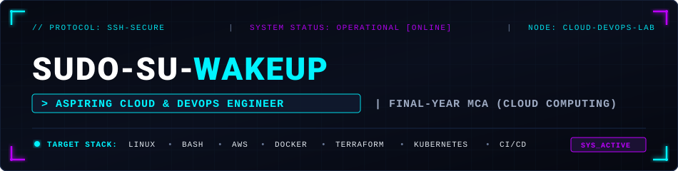

<div align="center">

  <!-- Cyberpunk Banner -->
  

  <br><br>

  <!-- Animated Typing Stream -->
  <a href="https://github.com/Sudo-su-wakeup">
    
  </a>

  <br>

  <!-- Connect / Social Links -->
  <a href="https://github.com/Sudo-su-wakeup">
    
  </a>
  &nbsp;
  <!-- REPLACE THE LINKEDIN URL BELOW WITH YOUR PROFILE HANDLE -->
  <a href="https://www.linkedin.com/in/YOUR-LINKEDIN-HANDLE">
    
  </a>

</div>

<br>

---

### `// 01. TERMINAL_INIT :: whoami`

```bash
manish@devops-node:~$ whoami --verbose
┌───────────────────────┬────────────────────────────────────────────────────────┐
│ PARAMETER             │ VALUE                                                  │
├───────────────────────┼────────────────────────────────────────────────────────┤
│ USER_HANDLE           │ Sudo-su-wakeup                                         │
│ ACADEMIC_STATUS       │ Final-Year MCA Student (Specializing in Cloud Computing│
│ TARGET_ROLE           │ Aspiring Cloud & DevOps Engineer                       │
│ PRIMARY_ENVIRONMENT   │ Windows 11 (Host) + Linux VMs / Cloud Labs (AWS & Azure│
│ CORE_PURSUIT          │ Infrastructure as Code, Automation, Systems Scripting  │
│ CURRENT_STATUS        │ Actively building hands-on labs & documenting projects │
└───────────────────────┴────────────────────────────────────────────────────────┘
```

---

### `// 02. TECH_STACK :: CORE COMPETENCIES`

<p align="center">
  
  
  
  
  
  
  
  
</p>

---

### `// 03. FEATURED_PROJECT :: ACTIVE DEPLOYMENT`

<table>
  <tr>
    <td width="100%">
      <h4>
        <a href="https://github.com/Sudo-su-wakeup/linux-system-health-reporter">
          🐧 Linux System Health Reporter
        </a>
        &nbsp;<code>[STATUS: VERIFIED & COMPLETED]</code>
      </h4>
      <p>
        A lightweight Bash automation utility engineered to capture vital Linux server diagnostics in real time. Designed for server administrators and cloud instances to rapidly check host metrics without overhead.
      </p>
      <ul>
        <li><b>Hostname & OS Detection:</b> Parses kernel and release details across distributions.</li>
        <li><b>Uptime & Availability:</b> Extracts accurate instance runtime metrics.</li>
        <li><b>Memory & Disk Monitoring:</b> Captures active memory consumption and root storage utilization.</li>
        <li><b>Cloud Verification:</b> Tested in live Linux environments, including AWS EC2.</li>
      </ul>
      <p>
        
        
        
        <a href="https://github.com/Sudo-su-wakeup/linux-system-health-reporter">
          
        </a>
      </p>
    </td>
  </tr>
</table>

---

### `// 04. SYSTEM_DOCS :: EXPANDABLE ARCHIVES`

<details>
  <summary><b>📂 [CLICK TO EXPAND] Detailed Technical Skills Matrix</b></summary>
  <br>

| Domain | Tools & Technologies | Focus Area |
| :--- | :--- | :--- |
| **Operating Systems & Scripting** | Linux (Ubuntu, Debian, CentOS), Bash, PowerShell | System monitoring, process control, file permissions, shell scripting |
| **Cloud Computing** | AWS (EC2, VPC, S3, IAM), Azure (Core Services & Labs) | Cloud resource provisioning, networking foundations, identity management |
| **Containers & Orchestration** | Docker, Docker Compose, Kubernetes (minikube/labs) | Containerizing workloads, image optimization, pod lifecycle management |
| **Infrastructure as Code (IaC)** | Terraform | Modular infrastructure declarations, state management fundamentals |
| **Version Control & Workflows** | Git, GitHub, GitHub Actions | Branching strategies, automated workflows, collaborative code reviews |

</details>

<details>
  <summary><b>📂 [CLICK TO EXPAND] Cloud & DevOps Learning Roadmap</b></summary>
  <br>

```
Phase 1: Foundations [COMPLETED]
  ├── Linux internals, shell navigation, system administration
  ├── Bash automation scripting & diagnostic logging
  └── Git version control workflows & repository management

Phase 2: Cloud & Virtualization [IN PROGRESS]
  ├── AWS core architecture: EC2 instances, VPC subnets, security groups, S3
  ├── Azure cloud analytics & compute laboratory exercises
  └── Multi-OS local virtualization on Windows 11 host (WSL2, Hyper-V, VMs)

Phase 3: Containers & Orchestration [IN PROGRESS]
  ├── Docker containerization: Dockerfiles, multi-stage builds, container networks
  └── Kubernetes fundamentals: Pods, Services, Deployments, ConfigMaps

Phase 4: Infrastructure as Code & CI/CD Pipelines [UPCOMING]
  ├── Terraform reusable modules for reproducible AWS infrastructure
  └── Automated GitHub Actions pipelines for linting, testing, and deployment
```

</details>

<details>
  <summary><b>📂 [CLICK TO EXPAND] Engineering Workflow & Philosophy</b></summary>
  <br>

- **Lab-First Learning:** Theory is reinforced by hands-on sandbox labs (AWS Free Tier, Azure Labs, and local hypervisors on Windows 11).
- **Automation Over Manual Steps:** If a configuration or diagnostics routine is performed more than twice, it gets scripted in Bash or codified in IaC.
- **Strict Version Control:** Every lab exercise, script, and configuration is versioned with clean commits and readable documentation.
- **Honest Engineering Growth:** Transparent progress tracking—documenting what works, debugging failures, and mastering root causes.

</details>

<details>
  <summary><b>📂 [CLICK TO EXPAND] Project Roadmap (Current vs. Planned)</b></summary>
  <br>

| Project Title | Target Technologies | Status | Objective |
| :--- | :--- | :--- | :--- |
| **Linux System Health Reporter** | Bash, Linux, AWS EC2 | 🟢 **Completed** | Real-time CLI system diagnostics & server telemetry |
| **Dockerized Microservice Deployment** | Docker, Nginx, Linux | 🟡 *Planned* | Containerizing a multi-tier app with health checks |
| **Terraform AWS Infrastructure Blueprint** | Terraform, AWS VPC, EC2 | 🟡 *Planned* | Codified, repeatable cloud infrastructure with remote state |
| **Kubernetes Declarative Cluster Setup** | K8s, Helm, Minikube | 🟡 *Planned* | Manifest-driven cluster orchestration with rolling updates |
| **End-to-End CI/CD Pipeline** | GitHub Actions, Docker, Cloud | 🟡 *Planned* | Automated build, test, and container registry publishing |

</details>

---

### `// 05. METRICS :: ACTIVITY & ANALYTICS`

<div align="center">
  <table border="0">
    <tr>
      <td align="center">
        
      </td>
      <td align="center">
        
      </td>
    </tr>
  </table>
  <sub><i>Note: External metrics cards render live GitHub telemetry.</i></sub>
</div>

---

<div align="center">

  `// 06. SYSTEM_LOGOUT :: EXPLORE REPOSITORIES`

  <br>

  <p>
    <b>Curious about my scripts or cloud configurations?</b><br>
    Feel free to explore my repositories, open an issue, or reach out to connect!
  </p>

  <a href="https://github.com/Sudo-su-wakeup?tab=repositories">
    
  </a>

  <br><br>

  <sub><code>[EOF] CONNECTION TERMINATED — SESSION SAVED</code></sub>

</div>
